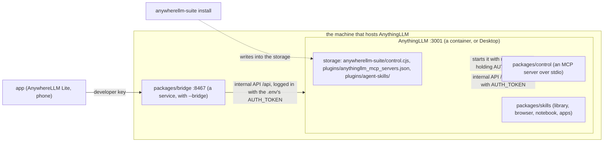

# Architecture

- **Nothing of the suite runs beside AnythingLLM unless the phone app needs the bridge.** `install` writes the control server and the skills into AnythingLLM's storage folder; AnythingLLM loads the skills into its own process and starts the control server as a child, over stdio, with its own `node` and its own environment. The same files work for a container and for Desktop on any OS; only the servers-file entry differs (the container's `node` and path, or the host's).
- **A request from the phone app** reaches the bridge with a developer key. The bridge asks AnythingLLM whether it takes the key (`GET /api/v1/auth`, remembered a minute), refuses a route `BRIDGE_ALLOW` doesn't list (403), and passes the rest to the internal API, logged in with AnythingLLM's password.
- **A call from the agent** reaches the control server from AnythingLLM itself, which calls the internal API on the same machine with the password AnythingLLM gave it. It calls only its own fixed routes, so `BRIDGE_ALLOW` doesn't apply to it.
- **Who holds which secret:** AnythingLLM's password (`AUTH_TOKEN`) stays with AnythingLLM: in its `.env`, which the bridge reads, and in the environment of the control server it starts. The servers file holds no secret. The phone app holds only a developer key (`pair` makes the one named `AnywhereLLM`).
