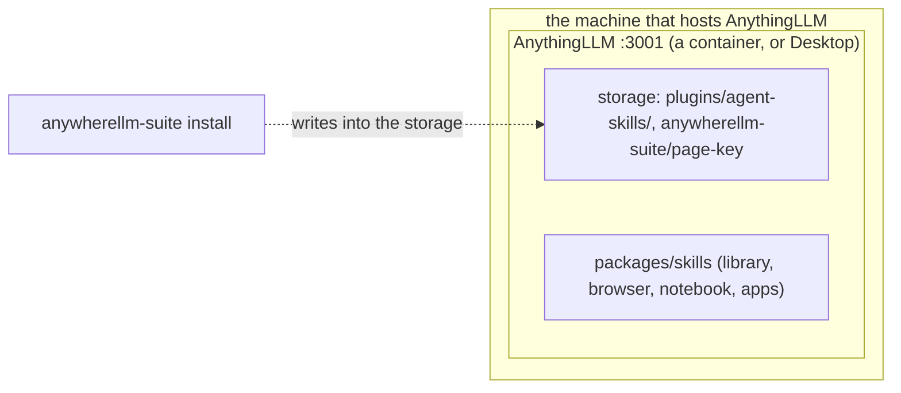

# Architecture

- **Nothing of the suite runs beside AnythingLLM.** `install` writes the skills into AnythingLLM's storage folder, and AnythingLLM loads them into its own process. The same files work for a container and for Desktop.
- **Who holds which secret:** AnythingLLM's password (`AUTH_TOKEN`) stays with AnythingLLM, and no skill reads it. The skills' pages post with a browser-extension key (`install --page-key`), kept in the storage.
- **The phone app's bridge** (AnywhereLLM Lite) and **the control server** (the agent's chat and scheduled-job tools) are a separate repository, anywherellm-bridge, with its own install.
