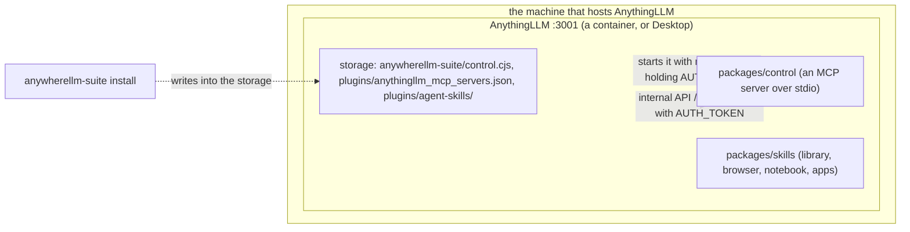

# Architecture

- **Nothing of the suite runs beside AnythingLLM.** `install` writes the control server and the skills into AnythingLLM's storage folder; AnythingLLM loads the skills into its own process and starts the control server as a child, over stdio, with its own `node` and its own environment. The same files work for a container and for Desktop on any OS; only the servers-file entry differs (the container's `node` and path, or the host's).
- **A call from the agent** reaches the control server from AnythingLLM itself, which calls the internal API on the same machine with the password AnythingLLM gave it, on its own fixed routes.
- **Who holds which secret:** AnythingLLM's password (`AUTH_TOKEN`) stays with AnythingLLM: in its `.env`, and in the environment of the control server it starts. The servers file holds no secret. The skills' pages post with a browser-extension key (`install --page-key`), kept in the storage.
- **The phone app's bridge** (AnywhereLLM Lite) is a separate repository, anywherellm-bridge, with its own install and service.
